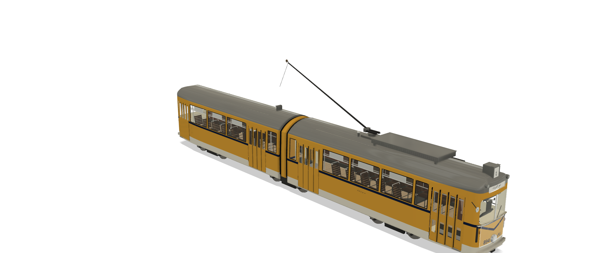
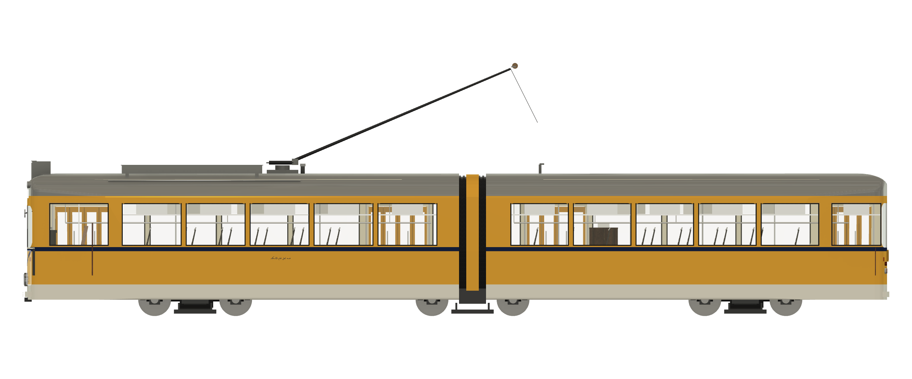
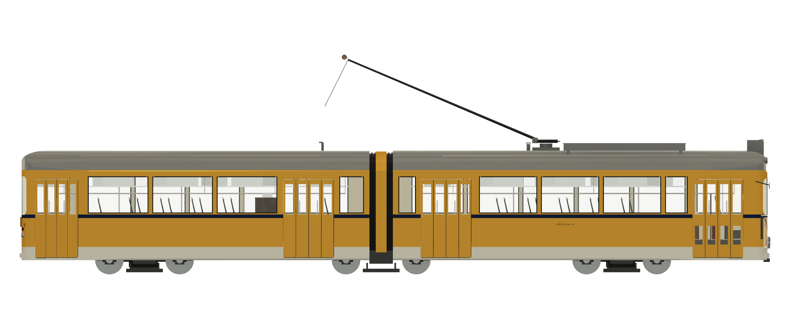
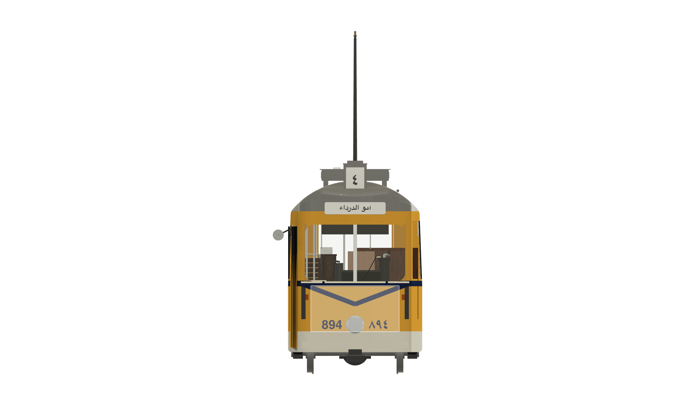
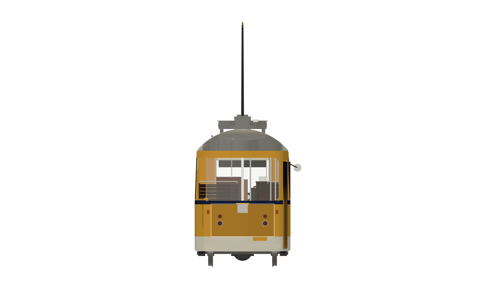
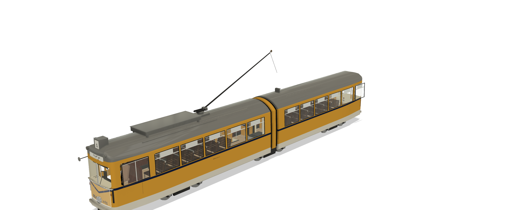
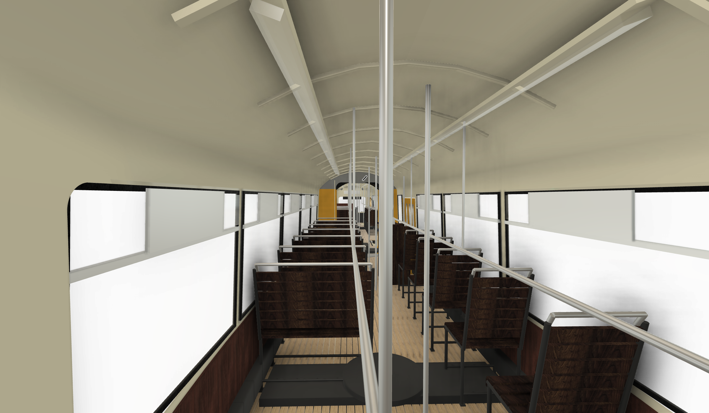

# Alexandria tram: Düwag GT6 894

A 1:1 parametric Fusion model of **tram 894**, an ex-Copenhagen **Düwag GT6** six-axle articulated car that has run
on the Alexandria (Egypt) city tram network since 1972. The model is built entirely by Python scripts from a
parameter table, with every dimension traced to a source or a photogrammetric measurement.

## The vehicle

- **Type:** Düwag "Einheits-Gelenkwagen" GT6: six axles, two body sections on three bogies (B'2'B': motored end
  bogies, Jacobs bogie under the articulation), **single-ended**, doors on the right side only. Kiepe electrics,
  600 V DC, standard gauge.
- **History:** Københavns Sporveje (KS) bought 100 GT6s (801–900) in seven batches, 1960–68. When Copenhagen
  closed its tramway, **99 cars went to Alexandria in 1969–72** and kept their KS numbers. **KS 894** (1966 batch)
  arrived in 1972 and was still in service in April 2024, green and white, on city route 4. KS 815 and 890 returned
  to the Skjoldenæsholm tram museum (Denmark) in 2001.
- **In Alexandria** the GT6s ran on the city (El-Madina) network as single cars, under trolley poles. A refurbished
  batch moved to Raml lines 5/6 around 2019, in light blue/white or red/white.

## What is modelled

Everything a viewer sees, inside and out:
- Body: two sections from one parametric cross-section (vertical lower side, 45 mm tumblehome window band, arched
  roof), plan taper and bowed end faces, roof-end domes, 3 mm shell.
- Openings, tilted side glazing with rubbers and hopper vents, two-pane windscreen and rear window, destination and
  route blinds, gangway.
- Four-panel folding doors with KS front-door lower lights, handles and entrance steps.
- Running gear: two Düwag tandem-drive motor bogies (cardan motor, chevron springs, track brakes) and the Jacobs bogie.
- Ends: headlight, marker and tail lamps, route boxes, bumper, indicators, mirror.
- Roof: trolley pole with spring base, harp and wheel, resistor cover, arrester, pole hook; optional diamond pantograph.
- Articulation: pleated bellows, portal ring, turntable plate.
- Interior: wood-slat floor, linings, ribbed ceiling, light strips, poles and rails, heaters, conductor's desk,
  36 wood-slat seats (2+1); cab with dash, gauges, Düwag controller, brake valve, pedals and driver's seat.
- Livery and lettering: five switchable liveries; CoreText-shaped Arabic and Western lettering as 0.3 mm decals
  (dash numbers 894 / ٨٩٤, route ٤, destination "أبو الدرداء", operator name, rear plate).

| | |
|---|---|
|  |  |
|  |  |
|  |  |

## Key dimensions

Confidence: **S** stated by a source · **S?** generic or analog source · **V** measured from dated photos ·
**E** estimate. Full sheet: [`references/notes/heritage-dossier.md`](references/notes/heritage-dossier.md) §2.

| Item | Value | Conf. | Source |
|---|---|---|---|
| Length over body | 19,095 mm | S | de.wikipedia (Straßenbahn Magazin 9/2008); TramTravels |
| Width | 2,200 mm | S | de.wikipedia, TramTravels |
| Roof crown | 3,150 mm (±100) | V | KS 818 broadside, 1969 (Commons 41468165) |
| Eave / window band | 2,650 / 1,540–2,490 mm | V | KS 818 |
| Floor | 880 mm | S? | generic GT6 |
| Section A / articulation centre | 9,590 / 9,890 mm | V | KS 818 |
| Bogie pivots | 3,730 / 9,890 / 15,950 mm | V | KS 818 (GT6-D analog 6.0 m spacing) |
| Bogie wheelbase / wheel | 1,800 / 680 mm | S? | VBK GT6-D analog |
| Door-side layout | 4 doors: 0.62, 7.58, 11.10, 17.65 m | V (LOW) | 821 (1974, oblique) + 807/845 close-ups |
| Seats | 36, 2+1 | S (count) | KS |

Method: 1-D projective rectification along the car side, scaled by the sourced length
([`references/notes/photogrammetry/rect1d.py`](references/notes/photogrammetry/rect1d.py)), checked by overlaying the
rectified KS 818 broadside on the model.

## Liveries and variants

User parameters in the Fusion design (re-run the appearance and lettering scripts after a change):

| `livery` | Scheme |
|---|---|
| **1** (default, rendered) | Alexandria city, c. 2000–2015: all-over ochre-yellow, dark-blue waist stripe dipping to a "V" on the front, pale roof and apron, blue numerals |
| 2 | APTA 1974: KS ochre / cream |
| 3 | Green / white, 2016+ (894 in 2024) |
| 4 | Raml lines 5/6 refurbished, 2019: light blue / white |
| 5 | Københavns Sporveje, 1960–72 |

`panto_on = 1` fits the diamond pantograph seen on the 2019 Raml-line car 899 instead of the trolley pole.
`door2_on = 0` plates over the second door (reported for Alexandria, date unknown). `car_no` sets the fleet number.

## Files

**Fusion** (project Eshera-Personal, folder *Alexandria Tram Model 3 - Duewag GT6 894*):

| Design | Contents |
|---|---|
| Alexandria Heritage Tram 894 | The complete car (single design, no assembly) |

**Exports** in [`models/`](models/):

| File | Format |
|---|---|
| `Alexandria Heritage Tram 894.f3d` | Fusion archive with the full timeline, user parameters and appearances |
| `Alexandria Heritage Tram 894.step` | STEP, solid geometry |

The `.f3d` excludes the photo underlays (canvases), because they are third-party images. They can be recreated
from the sources in `references/` (see "Photo underlay" in [`fusion/README.md`](fusion/README.md)).

## Opening the exports

- **Fusion:** File → Open → Open from my computer → the `.f3d`. The parameter table (Modify → Change Parameters)
  drives the scripts but not the imported timeline features by itself; to change a dimension, re-run the scripts.
- **Any other CAD (FreeCAD, Onshape, SolidWorks, Rhino, Blender via an importer):** open the `.step`. Units are
  millimetres, Y up, X from the cab end, Z lateral (the door side is −Z).

## Rebuilding from the scripts

The scripts in [`fusion/scripts/`](fusion/scripts/) rebuild the design from an empty document. They run inside
Fusion through a small exec loader; see [`fusion/README.md`](fusion/README.md) for the loader, the build order and
what each script makes. Lettering SVGs are generated on macOS with
[`tools/lettering/make_svgs.sh`](tools/lettering/make_svgs.sh) and the CoreText tool
[`text2svg.swift`](tools/lettering/text2svg.swift) (proper Arabic shaping); the generated SVGs are committed.

## Printing notes

- The model is a **1:1 master**. Scale on export: H0 1:87, TT 1:120, N 1:160, O 1:43.5/1:45, etc.
  At 1:87 the car is 219 mm long.
- The lettering decals are 0.3 mm thick at 1:1 and vanish at model scale: hide the *Lettering* component and use
  printed waterslide decals made from the SVGs in `tools/lettering/svg/`, or thicken them for multi-colour printing.
- Glazing panes, grab rails, the trolley pole and the bellows pleats are thinner than most printers can hold at small
  scales; thicken or replace them with wire/clear sheet. The body shell is 3 mm thick at 1:1.
- The interior is fully modelled; for a printed body shell, hide *Interior*, *Cab* and *Glazing*.

## Known gaps

- Right-side (door-side) window and door spacing: LOW confidence, from an oblique 1974 photo plus close-ups.
- Roof height ±0.1 m; tumblehome (45 mm) and plan taper shape are estimates.
- Whether 894 itself had its second door plated over is unknown (`door2_on`).
- Seat material is an estimate (varnished wood slats); the interior render shows a dark floor-base area at the rear
  of section B that may need slat cover.
- Only livery 1 is rendered.

## Credits and sources

Research sources (Wikipedia de/pl/cs/bg, TramTravels / sporvognsrejser.dk, Urban Transport Magazine, Ahram Gate,
bus-planet.com, TransPhoto) are cited in [`references/notes/research-raw.md`](references/notes/research-raw.md).
Reference photographs, notably Kurt Rasmussen's 1974/77 scans and Leif Jørgensen's KS 890 photos on Wikimedia
Commons, are **not** included; [`references/SOURCES.md`](references/SOURCES.md) lists every one with author,
licence and URL. Build decisions and Fusion API gotchas: [`docs/BUILD-LOG.md`](docs/BUILD-LOG.md).

## Licence

- Code (`fusion/`, `tools/`): MIT, see [`LICENSE`](LICENSE).
- Models, documentation and renders: CC BY 4.0, see [`LICENSE-models.md`](LICENSE-models.md).

© 2026 Ibrahim Eshera.

## Related models

| Repository | Vehicle |
|---|---|
| [alexandria-tram-raml-221-223](https://github.com/imeshera/alexandria-tram-raml-221-223) | Kinki Sharyo Raml three-car set 221–223 |
| [alexandria-tram-raml-dd-224](https://github.com/imeshera/alexandria-tram-raml-dd-224) | Raml double-deck car 224 and its set |
| [alexandria-tram-heritage-601](https://github.com/imeshera/alexandria-tram-heritage-601) | Raml heritage car 601 |
| [alexandria-tram-city-1211-1212](https://github.com/imeshera/alexandria-tram-city-1211-1212) | Ganz-MÁVAG city two-car set 1211+1212 |
| [alexandria-lada-taxi](https://github.com/imeshera/alexandria-lada-taxi) | Alexandria Lada taxi |
